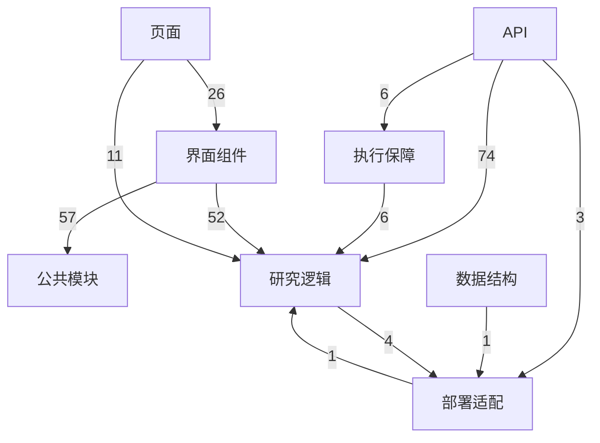

# 模块结构与 API 索引

<!-- Generated by source/scripts/sync-logic-docs.mjs. Do not edit by hand. -->

代码与生成器指纹：`ebecc5d58ada64de1ef804d6bad4cd32ec349261e00e87d3f165a7ea7dd3c197`。不使用生成时间，以保证重复运行结果一致。

人工语义图状态：**已按当前受监控核心文件复核**。详见[说明与更新规则](README.md)。

## 静态依赖图

箭头表示源码中的静态运行时 import，数字是导入语句数量。纯类型导入不计入。动态加载、间接调用与运行频次不在此图范围内。

## API 入口

动态参数保留目录形式。接口是否允许访问、调用预算与具体字段仍以服务端代码为准。

| 路径 | 导出方法 | 源码 |
| --- | --- | --- |
| `/api/diagnostics/model-connection` | GET, POST | [app/api/diagnostics/model-connection/route.ts](../../source/app/api/diagnostics/model-connection/route.ts) |
| `/api/diagnostics/research-flow` | GET, POST | [app/api/diagnostics/research-flow/route.ts](../../source/app/api/diagnostics/research-flow/route.ts) |
| `/api/evidence-links` | POST | [app/api/evidence-links/route.ts](../../source/app/api/evidence-links/route.ts) |
| `/api/model-status` | GET, POST | [app/api/model-status/route.ts](../../source/app/api/model-status/route.ts) |
| `/api/projects/[id]/conclusion-review` | POST, GET | [app/api/projects/[id]/conclusion-review/route.ts](../../source/app/api/projects/[id]/conclusion-review/route.ts) |
| `/api/projects/[id]/context` | POST | [app/api/projects/[id]/context/route.ts](../../source/app/api/projects/[id]/context/route.ts) |
| `/api/projects/[id]/harness` | GET | [app/api/projects/[id]/harness/route.ts](../../source/app/api/projects/[id]/harness/route.ts) |
| `/api/projects/[id]` | GET, PATCH, DELETE | [app/api/projects/[id]/route.ts](../../source/app/api/projects/[id]/route.ts) |
| `/api/projects/[id]/run` | POST, GET | [app/api/projects/[id]/run/route.ts](../../source/app/api/projects/[id]/run/route.ts) |
| `/api/projects/[id]/workflow/background` | POST | [app/api/projects/[id]/workflow/background/route.ts](../../source/app/api/projects/[id]/workflow/background/route.ts) |
| `/api/projects/[id]/workflow` | POST, GET | [app/api/projects/[id]/workflow/route.ts](../../source/app/api/projects/[id]/workflow/route.ts) |
| `/api/projects` | GET, POST | [app/api/projects/route.ts](../../source/app/api/projects/route.ts) |
| `/api/search` | POST | [app/api/search/route.ts](../../source/app/api/search/route.ts) |
| `/api/source-status` | GET | [app/api/source-status/route.ts](../../source/app/api/source-status/route.ts) |

## 来源候选与配置渠道

从采集器的候选声明提取，保留分支条件、常量和循环表达式。候选上限不是最终配额；去重、排序、余量转配、回源以及配置门控仍见对应源码。未声称这些渠道本轮全部执行。

| 候选名称 / 表达式 | 候选上限 | 局部条件 | 源码 |
| --- | --- | --- | --- |
| `channel.name` | `channel.cap` | `函数内 / 循环内` | [lib/research/collection.ts:113](../../source/lib/research/collection.ts#L113) |
| `'GitHub Issues 与人工评论'` | `3` | `profile!=='general'` | [lib/research/collection.ts:115](../../source/lib/research/collection.ts#L115) |
| `'GitHub 文档 · Dify 官方项目'` | `2` | `profile!=='general' && profile==='dify'` | [lib/research/collection.ts:116](../../source/lib/research/collection.ts#L116) |
| `'GitHub 文档 · n8n 官方项目'` | `2` | `profile!=='general' && 否：profile==='dify' && /\bn8n\b/i.test(query+' '+options.topic)` | [lib/research/collection.ts:117](../../source/lib/research/collection.ts#L117) |
| `'网页搜索发现'` | `1` | `profile!=='general' && options.webSearch` | [lib/research/collection.ts:118](../../source/lib/research/collection.ts#L118) |
| `'Hacker News'` | `3` | `profile!=='general'` | [lib/research/collection.ts:119](../../source/lib/research/collection.ts#L119) |
| `NEWS_SOURCE` | `1` | `profile!=='general' && chinese` | [lib/research/collection.ts:120](../../source/lib/research/collection.ts#L120) |
| `FEED_SOURCES[key].name` | `1` | `profile!=='general'` | [lib/research/collection.ts:121](../../source/lib/research/collection.ts#L121) |
| `WIKI_SOURCE` | `1` | `profile!=='general'` | [lib/research/collection.ts:122](../../source/lib/research/collection.ts#L122) |
| `'网页搜索发现'` | `1` | `否：profile!=='general' && options.webSearch` | [lib/research/collection.ts:124](../../source/lib/research/collection.ts#L124) |
| `NEWS_SOURCE` | `1` | `否：profile!=='general'` | [lib/research/collection.ts:125](../../source/lib/research/collection.ts#L125) |
| `STATISTICS_SOURCE` | `2` | `否：profile!=='general' && chinese` | [lib/research/collection.ts:126](../../source/lib/research/collection.ts#L126) |
| `'GitHub Issues'` | `1` | `否：profile!=='general'` | [lib/research/collection.ts:127](../../source/lib/research/collection.ts#L127) |
| `FEED_SOURCES[key].name` | `1` | `否：profile!=='general'` | [lib/research/collection.ts:128](../../source/lib/research/collection.ts#L128) |
| `'Hacker News'` | `3` | `否：profile!=='general' && !chinese` | [lib/research/collection.ts:129](../../source/lib/research/collection.ts#L129) |
| `WIKI_SOURCE` | `2` | `否：profile!=='general'` | [lib/research/collection.ts:130](../../source/lib/research/collection.ts#L130) |
| `'博查网页搜索'` | `1` | `s.bocha` | [lib/research/configured-sources.ts:12](../../source/lib/research/configured-sources.ts#L12) |
| `'GitHub Discussions'` | `1` | `s.discussions` | [lib/research/configured-sources.ts:13](../../source/lib/research/configured-sources.ts#L13) |
| `'产品社区 · '+key` | `2` | `函数内 / 循环内` | [lib/research/configured-sources.ts:14](../../source/lib/research/configured-sources.ts#L14) |
