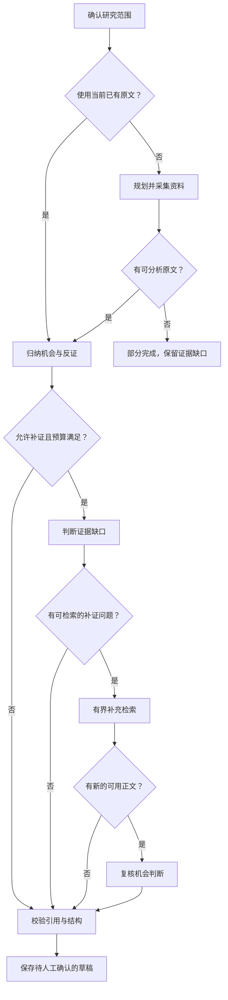
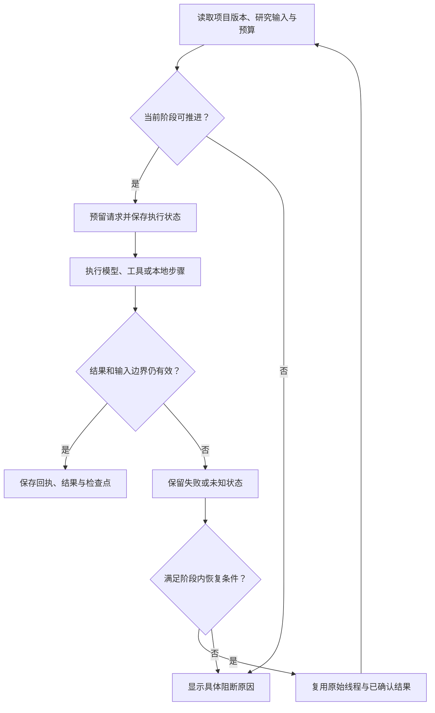

# 研究与执行的业务流程

这是一份人工核对的解释图。是否仍与当前受监控源码一致，请先看[自动生成文档顶部状态](WORKFLOW.generated.md)和[指纹记录](manifest.generated.json)。待复核时，不把本页当成最新事实。

## 单角色研究

- “已有原文”模式从分析开始，不重新规划、采集或调用工具。单角色轮结束后仍可复用正文启动新分析；旧记录和用量保留。
- V2EX 专用模式从节点采样开始，不走关键词规划与自动补搜；上图合并展示了资料采集步骤，精确模式见[阶段序列](WORKFLOW.generated.md)。
- 采集预算耗尽会本地收尾；已有原文仍可用于分析，没有正文则部分完成。没有搜到不等于没有需求。
- 模型可请求受限工具，但预算和来源资格由应用执行；搜索摘要不能冒充原文。
- 项目与工具阶段共用标题、人群及排除项组成的研究范围，排除项不会被当作正向产品词。公开开发任务、原型交付或不匹配的产品仓库资料可能被规则筛出。导入材料仍需人工核对，规则命中不能替代语义相关性判断。
- 正文与摘要按资料用途类型区分；正文裁剪不改变其原文资格。
- 发票、账单、访谈等主题可以检索；公开搜索不用于证明实际付款或私人账单事实，项目内已授权正文检索不受主题词拦截。
- 引用可定位只证明与输入资料有关，不保证语义支持或付费成立。

## 四角色复核

四角色复核已有冻结资料。独立反证不读取前序结论或解释性记忆；任务实际按待执行列表推进，不能把依赖图中的分支称为已经并行执行。角色依赖由代码生成，见[执行依赖图](EXECUTION.generated.md)。

需求、商业与反证的结果进入协调汇总，再做本地检查与草稿保存。多角色优于单角色尚需同输入、同口径的真实质量对照；四角色一致不能当作多个客户证据。

## 暂停、失败与恢复

- 模型 / 证据协议、来源配置和冻结输入变化时，不能盲目复用旧线程。
- 有未知操作回执时拒绝自动重发。暂停、取消或版本更新优先，迟到结果不能覆盖新状态。
- 已确认回执的输出截断，仅在当前输出上限高于失败用量、阶段及整轮有剩余额度时允许显式准备重试。准备不调用模型；继续推进时重新生成，不拼接或放行旧截断草稿。引用无效、超时及结果未知不开放这一恢复路径。
- 恢复不是重置预算；新增请求仍计入原轮剩余上限。显式重试、恢复旧检查点和阶段内恢复是不同操作。
- 后台任务以数据库租约和有界接力推进；中断后可能需要人工处理，不保证无限自动重启。

精确的拒绝原因、赋值表达式和源码行链接由[自动文档](README.md)提供。此图解释产品含义，不构成真实端到端验收报告。
