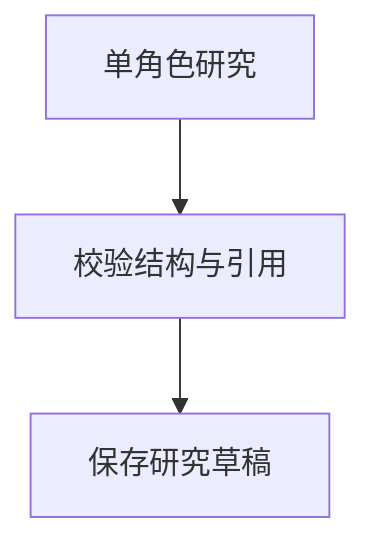
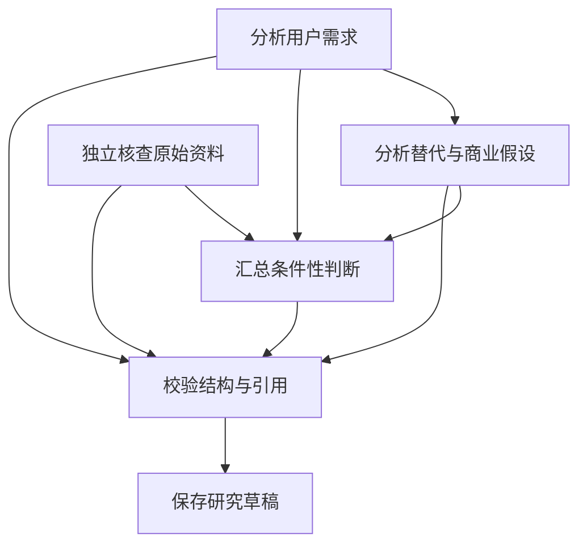

# 角色依赖、工具与恢复边界

<!-- Generated by source/scripts/sync-logic-docs.mjs. Do not edit by hand. -->

代码与生成器指纹：`951ff8e6766025a7698aa96796272d1fe0390d12b857fd1b4385f3b87d42e4a5`。不使用生成时间，以保证重复运行结果一致。

人工语义图状态：**已按当前受监控核心文件复核**。详见[说明与更新规则](README.md)。

## 执行任务依赖

以下依赖直接取自 `makeRun` 的任务声明及 `specs.push`。依赖没有先后关系的节点不代表实际并行执行；当前 `nextTask` 按待执行列表选取任务。

### 任务方案 1

条件：`mode==='single'`。源码：[lib/research/execution.ts:37](../../source/lib/research/execution.ts#L37)。

### 任务方案 2

条件：`否：mode==='single'`。源码：[lib/research/execution.ts:37](../../source/lib/research/execution.ts#L37)。

## 工具白名单

| 工具标识 | 来源 |
| --- | --- |
| `public_source_search` | [lib/research/agent-loop.ts:18](../../source/lib/research/agent-loop.ts#L18) |
| `hacker_news_search` | [lib/research/agent-loop.ts:18](../../source/lib/research/agent-loop.ts#L18) |
| `hacker_news_read` | [lib/research/agent-loop.ts:18](../../source/lib/research/agent-loop.ts#L18) |
| `zh_wikipedia_extract` | [lib/research/agent-loop.ts:18](../../source/lib/research/agent-loop.ts#L18) |
| `retrieve_project_evidence` | [lib/research/agent-loop.ts:18](../../source/lib/research/agent-loop.ts#L18) |

## 阶段内恢复的拒绝条件

按源码顺序列出拒绝恢复的分支，表中的条件是局部语法条件，不代替真实恢复验收。

| 局部条件 | 界面原因 | 源码 |
| --- | --- | --- |
| `!w?.harnessVersion` | 旧研究未启用阶段内恢复，请保留记录后开始新一轮。 | [lib/research/harness/recovery.ts:23](../../source/lib/research/harness/recovery.ts#L23) |
| `!p.confirmed&#124;&#124;p.mode!=='manual'&#124;&#124;p.archived&#124;&#124;['paused','completed','cancelled'].includes(p.status)&#124;&#124;w.revision!==p.revision&#124;&#124;w.evidenceVersion!==(p.evidenceVersion&#124;&#124;0)&#124;&#124;p.evidence.some(e=>e.kind==='synthetic')` | 研究范围或资料状态已变化，不能复用旧线程。 | [lib/research/harness/recovery.ts:24](../../source/lib/research/harness/recovery.ts#L24) |
| `p.run&&['ready','running','paused','failed'].includes(p.run.status)&#124;&#124;w.conclusionAudit&&['ready','running'].includes(w.conclusionAudit.status)` | 请先结束其他执行任务。 | [lib/research/harness/recovery.ts:25](../../source/lib/research/harness/recovery.ts#L25) |
| `!['failed','running'].includes(w.status)` | 当前阶段不需要恢复。 | [lib/research/harness/recovery.ts:26](../../source/lib/research/harness/recovery.ts#L26) |
| `w.lease&&Date.parse(w.lease.expires)>Date.now()` | 当前请求仍在执行，请等待结果或租约到期。 | [lib/research/harness/recovery.ts:27](../../source/lib/research/harness/recovery.ts#L27) |
| `!record?.input&#124;&#124;!record.harnessThreadId&#124;&#124;record.stage!==w.stage&#124;&#124;record.harnessThreadId!==′${p.id}:${w.id}:${record.id}′` | 当前阶段没有可复用的原始线程。 | [lib/research/harness/recovery.ts:29](../../source/lib/research/harness/recovery.ts#L29) |
| `!['','MODEL_REPORTED_ERROR','EXECUTION_INTERRUPTED'].includes(w.error)` | 本阶段未通过模型或业务检查，不能用线程恢复放行被拒结果。 | [lib/research/harness/recovery.ts:30](../../source/lib/research/harness/recovery.ts#L30) |
| `unknown?.n` | 请求结果不明，不能自动重发。请保留记录并核查服务用量。 | [lib/research/harness/recovery.ts:33](../../source/lib/research/harness/recovery.ts#L33) |
| `snapshot.sourcePolicy!==sourcePolicy()` | 来源渠道协议或配置已变化，不能复用旧线程。 | [lib/research/harness/recovery.ts:35](../../source/lib/research/harness/recovery.ts#L35) |
| `snapshot.model!==QWEN_MODEL&#124;&#124;snapshot.qualityPolicy!==QUALITY_POLICY_VERSION` | 模型或证据边界协议已变化，不能复用旧线程；请保留记录后准备新阶段。 | [lib/research/harness/recovery.ts:36](../../source/lib/research/harness/recovery.ts#L36) |
| `snapshot.task.call_id!==record.id&#124;&#124;snapshot.task.run_id!==w.id&#124;&#124;snapshot.task.project_id!==p.id&#124;&#124;snapshot.task.revision!==p.revision` | 原始输入与当前研究不一致。 | [lib/research/harness/recovery.ts:37](../../source/lib/research/harness/recovery.ts#L37) |
| `!checkpoint` | 尚无可恢复的执行检查点。 | [lib/research/harness/recovery.ts:39](../../source/lib/research/harness/recovery.ts#L39) |
| `catch / 其他早退` | 执行检查点暂不可读取，请稍后刷新。 | [lib/research/harness/recovery.ts:41](../../source/lib/research/harness/recovery.ts#L41) |

## 后台推进落点

| 后台状态 | 说明 | 源码 |
| --- | --- | --- |
| `stopped` | 项目或研究范围已变化，后台已停止。 | [lib/research/harness/background.ts:34](../../source/lib/research/harness/background.ts#L34) |
| `completed` | 本轮后台推进已结束，请查看成果与证据缺口。 | [lib/research/harness/background.ts:35](../../source/lib/research/harness/background.ts#L35) |
| `attention` | 当前检查点需要处理；后台不会自动重试失败或结果不明的请求。 | [lib/research/harness/background.ts:36](../../source/lib/research/harness/background.ts#L36) |
| `ready` | 进度已保存，等待下一段后台推进。 | [lib/research/harness/background.ts:42](../../source/lib/research/harness/background.ts#L42) |
| `attention` | 后台推进中断，已有结果保留。请刷新检查点并选择恢复方式。 | [lib/research/harness/background.ts:44](../../source/lib/research/harness/background.ts#L44) |
