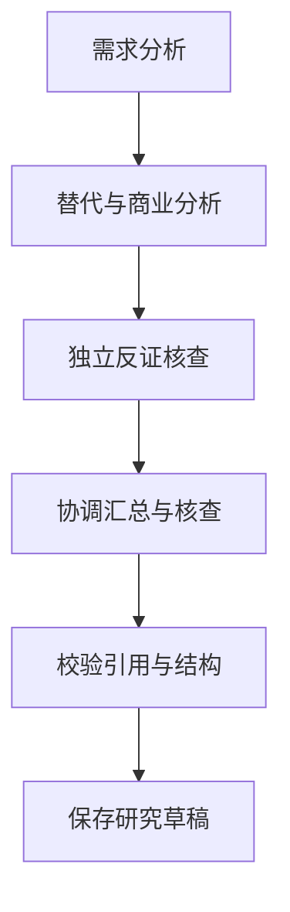
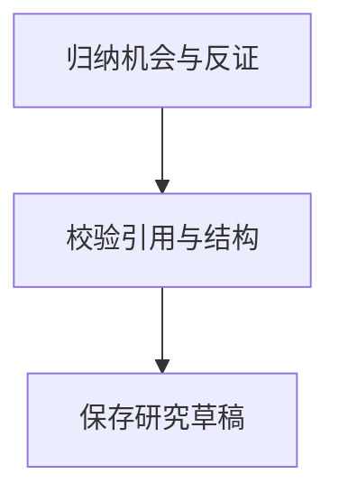
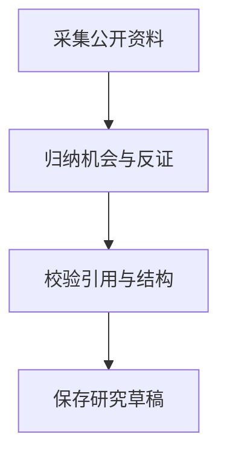
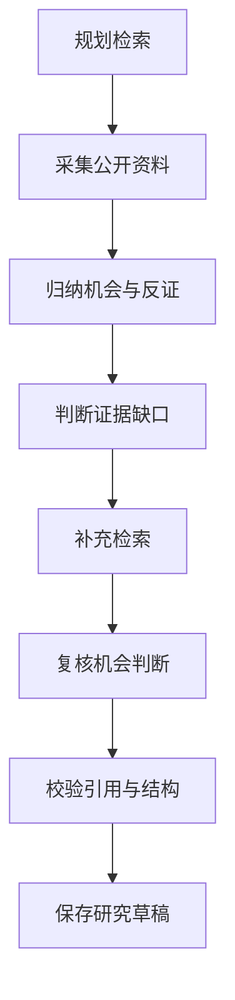

# 研究流程与转移清单

<!-- Generated by source/scripts/sync-logic-docs.mjs. Do not edit by hand. -->

代码与生成器指纹：`3beaa040a59985be520339a2cf3a14e7656d8d6109296dc97a72eec399fb659e`。不使用生成时间，以保证重复运行结果一致。

人工语义图状态：**已按当前受监控核心文件复核**。详见[说明与更新规则](README.md)。

## 界面阶段序列

以下箭头从 `stagesFor` 的实际阶段数组生成，表示界面展示顺序。可选步骤可能被跳过；它不是完整运行时状态机。具体分支见下方转移清单。

### 路径 1

选择条件：`w?.mode==='four'`。源码：[lib/research/workflow.ts:20](../../source/lib/research/workflow.ts#L20)。

### 路径 2

选择条件：`否：w?.mode==='four'`；`w?.useExistingEvidence`。源码：[lib/research/workflow.ts:20](../../source/lib/research/workflow.ts#L20)。

### 路径 3

选择条件：`否：w?.mode==='four'`；`否：w?.useExistingEvidence`；`w?.sourceProfile==='v2ex'`。源码：[lib/research/workflow.ts:20](../../source/lib/research/workflow.ts#L20)。

### 路径 4

选择条件：`否：w?.mode==='four'`；`否：w?.useExistingEvidence`；`否：w?.sourceProfile==='v2ex'`。源码：[lib/research/workflow.ts:20](../../source/lib/research/workflow.ts#L20)。

## 阶段类型

| 阶段 | 类型 | 源码 |
| --- | --- | --- |
| 规划检索 `plan` | 模型阶段 | [lib/research/workflow.ts:19](../../source/lib/research/workflow.ts#L19) |
| 采集公开资料 `collect` | 来源阶段 | [lib/research/workflow.ts:19](../../source/lib/research/workflow.ts#L19) |
| 归纳机会与反证 `analyze` | 模型阶段 | [lib/research/workflow.ts:19](../../source/lib/research/workflow.ts#L19) |
| 判断证据缺口 `gap` | 模型阶段 | [lib/research/workflow.ts:19](../../source/lib/research/workflow.ts#L19) |
| 补充检索 `supplement` | 来源阶段 | [lib/research/workflow.ts:19](../../source/lib/research/workflow.ts#L19) |
| 复核机会判断 `reanalyze` | 模型阶段 | [lib/research/workflow.ts:19](../../source/lib/research/workflow.ts#L19) |
| 校验引用与结构 `check` | 本地阶段 | [lib/research/workflow.ts:19](../../source/lib/research/workflow.ts#L19) |
| 保存研究草稿 `deliver` | 本地阶段 | [lib/research/workflow.ts:19](../../source/lib/research/workflow.ts#L19) |
| 需求分析 `needs` | 模型阶段 | [lib/research/workflow.ts:19](../../source/lib/research/workflow.ts#L19) |
| 替代与商业分析 `commercial` | 模型阶段 | [lib/research/workflow.ts:19](../../source/lib/research/workflow.ts#L19) |
| 独立反证核查 `verifier` | 模型阶段 | [lib/research/workflow.ts:19](../../source/lib/research/workflow.ts#L19) |
| 协调汇总与核查 `synthesis` | 模型阶段 | [lib/research/workflow.ts:19](../../source/lib/research/workflow.ts#L19) |
## 阶段与状态赋值

按 TypeScript 语法树枚举工作流模块及工作流 API 中的直接赋值，保留代码条件与动态表达式。这里的“否”是对应 if / 三元条件的另一分支；早退、循环与被调用函数内部的条件仍需结合源码阅读，不声称是完整路径约束。

| 函数 | 字段 | 新值 / 表达式 | 外层条件 | 源码 |
| --- | --- | --- | --- | --- |
| `stopWithoutEvidence` | `w.status` | `'partial'` | `函数内无外层 if 条件` | [lib/research/workflow.ts:123](../../source/lib/research/workflow.ts#L123) |
| `stopWithoutEvidence` | `p.status` | `'partial'` | `函数内无外层 if 条件` | [lib/research/workflow.ts:123](../../source/lib/research/workflow.ts#L123) |
| `closeCollectionAtLimit` | `w.stage` | `close.next` | `否：close.next==='partial'` | [lib/research/workflow.ts:148](../../source/lib/research/workflow.ts#L148) |
| `controlWorkflow` | `w.status` | `'cancelled'` | `action==='cancel'` | [lib/research/workflow.ts:181](../../source/lib/research/workflow.ts#L181) |
| `controlWorkflow` | `w.status` | `'paused'` | `action==='pause'` | [lib/research/workflow.ts:183](../../source/lib/research/workflow.ts#L183) |
| `controlWorkflow` | `w.status` | `w.needsRetry?'failed':'ready'` | `action==='resume'` | [lib/research/workflow.ts:184](../../source/lib/research/workflow.ts#L184) |
| `controlWorkflow` | `w.status` | `'failed'` | `action==='recover'` | [lib/research/workflow.ts:185](../../source/lib/research/workflow.ts#L185) |
| `controlWorkflow` | `w.status` | `'ready'` | `函数内无外层 if 条件` | [lib/research/workflow.ts:188](../../source/lib/research/workflow.ts#L188) |
| `afterAnalyze` | `w.stage` | `'gap'` | `w.allowSupplement&&w.stage==='analyze'&&w.budget.modelAttempts+2<=w.budget.modelLimit&&w.budget.sourceAttempts+SOURCE_REQUEST_CAP<=w.budget.sourceLimit&&w.budget.searches<w.budget.searchLimit&&p.budget.searches<6` | [app/api/projects/[id]/workflow/route.ts:32](../../source/app/api/projects/[id]/workflow/route.ts#L32) |
| `afterAnalyze` | `w.stage` | `'check'` | `否：w.allowSupplement&&w.stage==='analyze'&&w.budget.modelAttempts+2<=w.budget.modelLimit&&w.budget.sourceAttempts+SOURCE_REQUEST_CAP<=w.budget.sourceLimit&&w.budget.searches<w.budget.searchLimit&&p.budget.searches<6` | [app/api/projects/[id]/workflow/route.ts:32](../../source/app/api/projects/[id]/workflow/route.ts#L32) |
| `POST` | `w.status` | `'failed'` | `isModel&&!resuming` | [app/api/projects/[id]/workflow/route.ts:82](../../source/app/api/projects/[id]/workflow/route.ts#L82) |
| `POST` | `w.status` | `'running'` | `函数内无外层 if 条件` | [app/api/projects/[id]/workflow/route.ts:98](../../source/app/api/projects/[id]/workflow/route.ts#L98) |
| `POST` | `cw.status` | `'failed'` | `current.version!==expectedVersion&#124;&#124;current.workflow?.id!==w.id&#124;&#124;current.workflow?.lease?.callId!==b.callId&#124;&#124;current.workflow.status!=='running'&#124;&#124;Date.parse(current.workflow.lease.expires)<=Date.now() && current.workflow?.id===w.id&&current.workflow.lease?.callId===b.callId` | [app/api/projects/[id]/workflow/route.ts:145](../../source/app/api/projects/[id]/workflow/route.ts#L145) |
| `POST` | `cw.status` | `'failed'` | `error` | [app/api/projects/[id]/workflow/route.ts:181](../../source/app/api/projects/[id]/workflow/route.ts#L181) |
| `POST` | `cw.status` | `'ready'` | `函数内无外层 if 条件` | [app/api/projects/[id]/workflow/route.ts:186](../../source/app/api/projects/[id]/workflow/route.ts#L186) |
| `POST` | `cw.stage` | `'collect'` | `output && stage==='plan' && cw.collectIndex<cw.queries.length` | [app/api/projects/[id]/workflow/route.ts:191](../../source/app/api/projects/[id]/workflow/route.ts#L191) |
| `POST` | `cw.stage` | `'analyze'` | `output && stage==='plan' && 否：cw.collectIndex<cw.queries.length && cw.usableIds.length&#124;&#124;current.evidence.some(e=>e.kind==='imported'&&!e.excluded)` | [app/api/projects/[id]/workflow/route.ts:191](../../source/app/api/projects/[id]/workflow/route.ts#L191) |
| `POST` | `cw.stage` | `'reanalyze'` | `output && 否：stage==='plan' && stage==='gap' && queries.length && (cw.agentFetchedQueries&#124;&#124;[]).some(query=>normalizeQuery(query)===normalizeQuery(queries[0])) && cw.freshIds.length` | [app/api/projects/[id]/workflow/route.ts:196](../../source/app/api/projects/[id]/workflow/route.ts#L196) |
| `POST` | `cw.stage` | `'check'` | `output && 否：stage==='plan' && stage==='gap' && queries.length && (cw.agentFetchedQueries&#124;&#124;[]).some(query=>normalizeQuery(query)===normalizeQuery(queries[0])) && 否：cw.freshIds.length` | [app/api/projects/[id]/workflow/route.ts:196](../../source/app/api/projects/[id]/workflow/route.ts#L196) |
| `POST` | `cw.stage` | `'supplement'` | `output && 否：stage==='plan' && stage==='gap' && queries.length && 否：(cw.agentFetchedQueries&#124;&#124;[]).some(query=>normalizeQuery(query)===normalizeQuery(queries[0]))` | [app/api/projects/[id]/workflow/route.ts:197](../../source/app/api/projects/[id]/workflow/route.ts#L197) |
| `POST` | `cw.stage` | `'check'` | `output && 否：stage==='plan' && stage==='gap' && 否：queries.length` | [app/api/projects/[id]/workflow/route.ts:199](../../source/app/api/projects/[id]/workflow/route.ts#L199) |
| `POST` | `cw.stage` | `r.tasks.find(t=>t.status==='pending'&&t.deps.every(id=>r.tasks.find(x=>x.id===id)?.status==='done'))!.id as typeof cw.stage` | `output && 否：stage==='plan' && 否：stage==='gap' && cw.mode==='four'` | [app/api/projects/[id]/workflow/route.ts:201](../../source/app/api/projects/[id]/workflow/route.ts#L201) |
| `POST` | `cw.stage` | `'reanalyze'` | `collection && stage==='supplement' && merged.newIds.length` | [app/api/projects/[id]/workflow/route.ts:211](../../source/app/api/projects/[id]/workflow/route.ts#L211) |
| `POST` | `cw.stage` | `'check'` | `collection && stage==='supplement' && 否：merged.newIds.length` | [app/api/projects/[id]/workflow/route.ts:211](../../source/app/api/projects/[id]/workflow/route.ts#L211) |
| `POST` | `cw.stage` | `'collect'` | `collection && 否：stage==='supplement' && cw.collectIndex<cw.queries.length` | [app/api/projects/[id]/workflow/route.ts:212](../../source/app/api/projects/[id]/workflow/route.ts#L212) |
| `POST` | `cw.stage` | `'analyze'` | `collection && 否：stage==='supplement' && 否：cw.collectIndex<cw.queries.length && cw.usableIds.length&#124;&#124;current.evidence.some(e=>e.kind==='imported'&&!e.excluded)` | [app/api/projects/[id]/workflow/route.ts:212](../../source/app/api/projects/[id]/workflow/route.ts#L212) |
| `POST` | `cw.stage` | `'deliver'` | `!isModel&&!isSource && stage==='check'` | [app/api/projects/[id]/workflow/route.ts:217](../../source/app/api/projects/[id]/workflow/route.ts#L217) |
| `POST` | `cw.status` | `'completed'` | `!isModel&&!isSource && 否：stage==='check'` | [app/api/projects/[id]/workflow/route.ts:219](../../source/app/api/projects/[id]/workflow/route.ts#L219) |
| `POST` | `current.status` | `'awaiting_decision'` | `!isModel&&!isSource && 否：stage==='check'` | [app/api/projects/[id]/workflow/route.ts:219](../../source/app/api/projects/[id]/workflow/route.ts#L219) |

初始阶段表达式：`useExistingEvidence?'analyze':mode==='four'?'needs':sourceProfile==='v2ex'?'collect':'plan'`。源码：[lib/research/workflow.ts:47](../../source/lib/research/workflow.ts#L47)。
